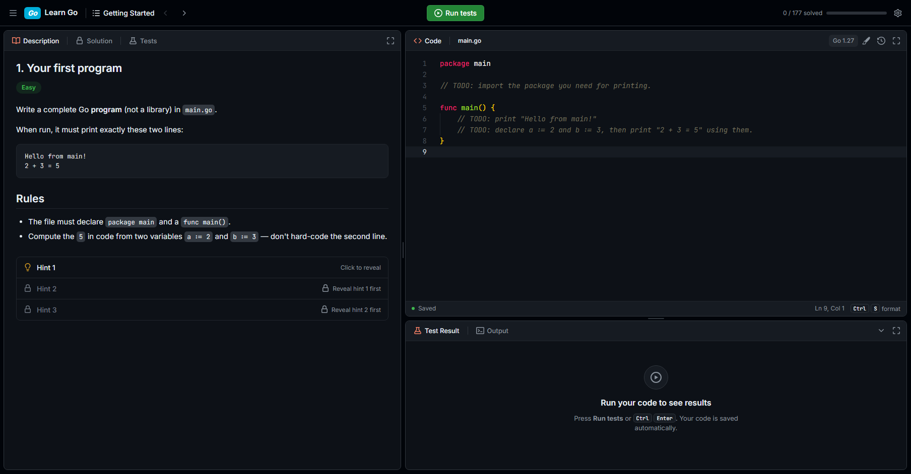

<div align="center">

# Learn Go

**Learn Go by solving problems, LeetCode-style, on your own machine.**

307 exercises · instant feedback · hints when you're stuck



</div>

## Features

- Short lessons, each followed by about 10 exercises from easy to hard
- An in-browser code editor that saves automatically
- Instant results: **Accepted**, **Wrong Answer** or **Compile Error**, with the exact failing input
- Hints that unlock one at a time, and a solution once you pass
- Built for **Go 1.27**

## Curriculum

| Module | Topics |
|---|---|
| 1 · Foundations | Variables, control flow, functions, strings |
| 2 · Composite Types | Slices, maps, structs, pointers |
| 3 · Methods, Interfaces & Errors | Methods, interfaces, `io`, error handling |
| 4 · Generics, Packages & Testing | Generics, iterators, packages, writing your own tests |
| 5 · Concurrency | Goroutines, channels, `select`, mutexes, `context`, patterns |

More modules are coming: REST APIs, databases and microservices.

## Getting started

1. **Install Go** from <https://go.dev/dl/>. An older version is fine too, because Go 1.27 downloads automatically.

2. **Clone the repository and start the platform:**

   ```sh
   git clone https://github.com/proatik/learning-go.git
   cd learning-go
   go run ./platform
   ```

3. **Open <http://localhost:8080>** in your browser.

## How it works

- Read the task on the left and write your code on the right.
- Press **Run tests** (`Ctrl + Enter`) to check your solution.
- Stuck? Reveal a hint at the bottom of the task.
- Your code and progress are saved in `workspace/`. It's created on the first run and git ignores it.

## Troubleshooting

- **Port 8080 is busy:** run `go run ./platform -addr localhost:9090`.
- **The editor doesn't load:** you need an internet connection, because the editor loads from a CDN.
- **You want to start over:** go to **Settings → Reset everything**.

## License

[MIT](LICENSE)
